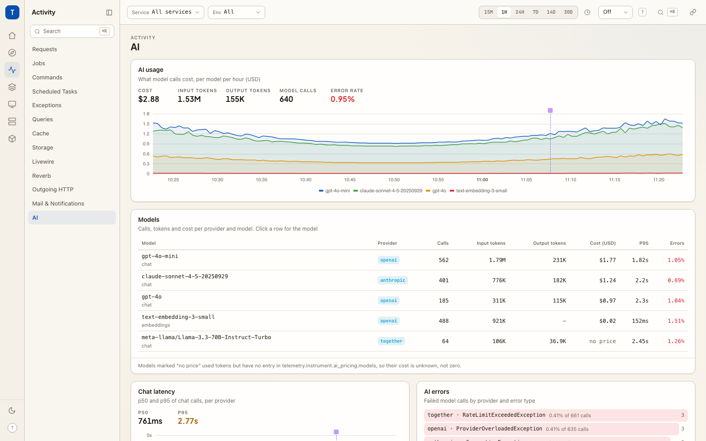

# AI usage and cost

`cboxdk/laravel-telemetry` instruments [laravel/ai](https://github.com/laravel/ai)
with the OpenTelemetry GenAI conventions. When those metrics reach your
Prometheus, the **AI** page appears under *Activity*. Until then it stays out
of the navigation: it is detected on `gen_ai_.*`.



## Turn it on (in the emitter)

The instrumentation is on by default in the emitting app
(`TELEMETRY_INSTRUMENT_AI=true`). To see cost as well as tokens, give it your
model prices, per 1M tokens:

```php
// config/telemetry.php
'instrument' => [
    'ai_pricing' => [
        'currency' => env('TELEMETRY_AI_CURRENCY', 'USD'),
        'models' => [
            'anthropic/claude-sonnet-*' => ['input' => 3.00, 'output' => 15.00, 'cache_read' => 0.30, 'cache_write' => 3.75],
            'openai/text-embedding-3-small' => ['input' => 0.02],
        ],
    ],
],
```

No price catalog ships with either package. A model without a price gets no
cost series, so the dashboard shows it as **no price**, never as free.

The cost counter (`gen_ai_client_cost_total`) needs laravel-telemetry 3.7 or
later in the emitting app. Older versions still fill every other panel on
the page, and the cost columns show the pricing hint.

## The panels

| Panel | Reads | Shows |
| --- | --- | --- |
| AI usage | `gen_ai_client_cost_total`, `gen_ai_client_token_usage_sum`, `gen_ai_client_operation_duration_seconds_count` | Cost per model per hour when prices are set, tokens per model per minute otherwise. Tiles: cost, input and output tokens, model calls, error rate. |
| Models | the same, plus `gen_ai_client_operation_duration_seconds_bucket` | One row per provider and model: calls (with chat / embeddings), input and output tokens, cost or *no price*, p95 latency, error rate. A row opens the model's page. |
| Chat latency | `gen_ai_client_operation_duration_seconds_bucket{gen_ai_operation_name="chat"}` | p50 and p95 per provider over time. Embeddings are left out: they would flatten the chat lines. |
| AI errors | `gen_ai_client_operation_duration_seconds_count{error_type!=""}` | Failed calls by provider and `error_type`, each with its share of that provider's calls. |
| AI usage by … | Loki usage records, else Tempo `chat` / `embeddings` spans | Calls, input and output tokens, cost (or *no price*, with a count of unpriced calls), error rate and last call per user, declared dimension (team, tenant, …), client IP or any attribute. A value opens its entity page when it has one, its traces otherwise. |
| Recent model calls | Tempo: `chat` and `embeddings` spans | One row per call: model and where it came from, tokens (with reasoning), cache read / write, cost, finish reason or error, duration. Sortable by time, duration or cost. A row opens the trace. |
| Slowest agent runs | Tempo: `invoke_agent` spans | Agent, model, tokens, cost (`gen_ai.usage.cost`), the tools the run called, finish reason or error, and duration. Sortable by time, duration or cost. A row opens the waterfall with its `chat` and `execute_tool` children. |
| Agent tools | Tempo: `execute_tool` spans | Runs, average and max duration per tool. A row opens the slowest run. |

The trace panels are built from a sample of recent traces (a Tempo
search), not totals. Without a reachable traces backend they show the
backend's error, as every trace panel does; the metric panels are unaffected.

## Usage by user, team, tenant or IP

*AI usage by …* groups model calls by a context dimension. The picker
offers the user, every dimension the app declares with
`TelemetryUi::dimension()` (so a declared `tenant.id` or `team.id` shows up
by itself), the client IP, and *Custom attribute…* for anything else that
`Telemetry::context()` adds, such as `plan`.

The panel reads the best source available, and its footer says which:

- **Usage records (exact).** With `instrument.ai_usage_events` on, the
  emitter writes one unsampled `gen_ai.client.inference.operation.details`
  log record per call. Read from Loki, the panel covers every call in the
  period, up to 5,000 records per read; past that it says it is the most
  recent 5,000.
- **Spans (recent sample).** Without records it reads the `chat` and
  `embeddings` spans, which carry `user.id` and the context dimensions too.
  A Tempo search returns the most recent 100 traces and a few calls from
  each, so even at 100% sampling this is a recent sample, not a total.
- **Client IP.** `client.address` is only on the request's root span, so
  IP always reads spans: the root spans above the calls
  (`{call} << {root}`), joined to the calls by trace.

Metric labels from `instrument.ai_metric_labels` are not read here yet;
the records already give exact numbers for any key, bounded or not.

### On a user's or tenant's page

When the app emits GenAI metrics, the entity page of a user, a client IP
and every declared context dimension gets the AI usage panels on its
*Metrics* tab: *AI usage* (calls over time, tokens, cost, error rate, from
the same source as above) and that value's *Model calls* from Tempo, each
opening its trace. An entity that has its own detail page keeps it, and a
host can attach a different page with `TelemetryUi::entityPage()`.

## Model and agent pages

A model and an agent are entities, like a route or an outgoing host: click a
row in *Models*, or a model or agent name in a list, and its page opens
(`/entity/ai-model?value=gpt-4o`, `/entity/ai-agent?value=SupportAgent`).
Both appear under *Entities* in Explore as **AI models** and **Agents**.

The *Story* tab is the usual entity story over the spans carrying
`gen_ai.request.model` or `gen_ai.agent.name`. The *Metrics* tab holds the
detail panels:

| Page | Panels |
| --- | --- |
| AI model | *Calls* per minute with failures, *Tokens* per minute with cost (or *No price*), *Latency* p50 / p95, and the model's *Calls* list from Tempo. |
| Agent | *Runs* over time with runs, failures, average duration and cost, the tools its runs called, and its run log, newest first. |

Agents have no metric label, so every agent number comes from a sample of
its most recent runs (one Tempo search), and each panel says so.

The *Tools* column in run lists comes from one structural search
(`{run} >> {execute_tool}`). Tempo returns a few matched spans per trace, so a
run that called many tools lists the first few; the waterfall shows all of
them.

## Currency

The cost counter carries no currency label. The dashboard reads
`telemetry.instrument.ai_pricing.currency` from its own config (USD when
unset), which is right when it runs inside the app it watches. A dashboard
watching a different app should set the same `TELEMETRY_AI_CURRENCY`.
